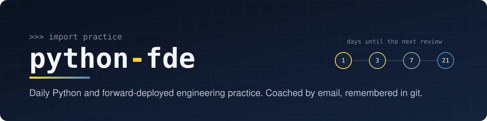
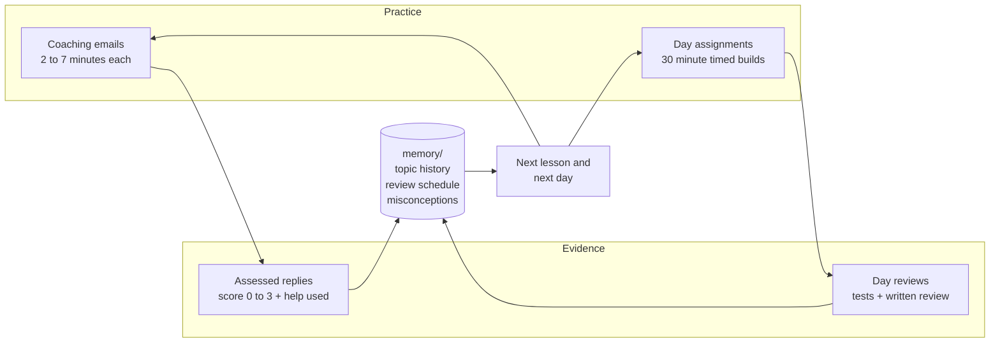

<p align="center">
  
</p>

<p align="center">
  <a href="https://github.com/ozgurgulerx/python-fde/actions/workflows/ci.yml"></a>
  
  
  
  <a href="LICENSE"></a>
</p>

I'm working through Python from the ground up, aimed at forward-deployed engineering interviews: small timed builds, code I can explain line by line, and honest records of what I got wrong.

This repository holds three things:

- **A coach** that emails me short lessons through the day and grades my replies.
- **A day ladder**: one timed assignment per study day, with tests.
- **A memory** of every attempt, so each new lesson and assignment is chosen from what I actually did, not from a fixed syllabus.

## Progress

<!-- progress:start -->
| Lessons sent | Questions answered | Scored attempts | Days reviewed | Reviews due | Open misconceptions |
| :---: | :---: | :---: | :---: | :---: | :---: |
| 1 | 0 / 1 | 0 | 0 / 1 | 0 | 0 |

### Days

| Day | Assignment | Topics | Status | Score | Review |
| :-- | :-- | :-- | :-- | :-: | :-- |
| [01](days/day01/) | A support ticket, by hand | `values`, `strings`, `conditionals`, `mutation` | Assigned | – | – |

### Topics

_No scored attempts yet. This table fills in as answers and days are reviewed._

<sub>Last synced 2026-11-11 by `tools/sync.py`.</sub>
<!-- progress:end -->

## How it works



1. **Practice.** The coach sends lessons at random times through the day; I answer by replying. Separately, I do one timed assignment from [`days/`](days/).
2. **Evidence.** Every reply is scored 0 to 3, along with how much help I had. Every day gets a written review. Unanswered questions are not failures and score nothing.
3. **Memory.** [`coach/scripts/memory.py`](coach/scripts/memory.py) turns that evidence into a profile: full attempt history per topic, when each topic is due again, and which misconceptions are still open.
4. **Adaptation.** The lesson designer receives the profile on every run. Due reviews come back as fresh tasks, open misconceptions are retested with new examples, and lesson formats I tend to answer are preferred.

A nightly job writes the profile and the lesson log into [`memory/`](memory/) and pushes, so the git history of that folder is the progress record.

### The review ladder

| After an unaided pass |  1st  |  2nd   |  3rd   | 4th and later |
| :-------------------- | :---: | :----: | :----: | :-----------: |
| Topic comes back in   | 1 day | 3 days | 7 days |    21 days    |

A miss, or an attempt made with hints or AI help, resets the topic to 1 day. A topic counts as **retained** only after two unaided passes at least a week apart. Details are in [`memory/README.md`](memory/README.md).

## Repository layout

```text
python-fde/
├── days/            one folder per assignment: brief, stubs, tests, notes, review
│   └── harness.py   untouched functions skip, wrong answers fail
├── memory/          the learner profile, lesson log and day ledger
├── coach/           the email coach
│   ├── SKILL.md     operating rules for the agent that runs it
│   ├── scripts/     scheduler, mail transport, assessment, memory, portal
│   ├── tests/       standard-library unit tests
│   └── references/  first lesson (the question bank stays private)
├── tools/           sync memory into this repository
└── AGENTS.md        how a day is assigned and reviewed
```

## Working a day

```bash
# read the brief
open days/day01/README.md

# fill in days/day01/solution.py, then run the tests
python3 -m unittest discover -s days/day01 -v

# submit
git add days/day01 && git commit -m "day01: support ticket functions" && git push
```

The review lands in `days/dayNN/REVIEW.md`, the result goes into `memory/days.json`, and the next day is built from both.

## About the coach

The coach is a scheduled Python program with no third-party dependencies. It plans randomised send times, asks a language model to design one lesson, sends it through a mail connector, reads replies only in its own threads, and grades them against the question it asked. It treats delivery carefully: a message is frozen to disk before sending, counted only once the send is confirmed, and never resent automatically.

It is built around my own setup (the Codex CLI, a Gmail connector, macOS launchd), so it is here as a working example, not a packaged tool. The interview question bank and my personal context files are not in the repository; [`coach/references/README.md`](coach/references/README.md) describes their shape.

```bash
# coach tests
cd coach && python3 -m unittest discover -s tests

# refresh memory/ and the progress table from local coach state
python3 tools/sync.py
```

## Licence

[MIT](LICENSE). The lessons and reviews are my own study notes; use anything that helps.
